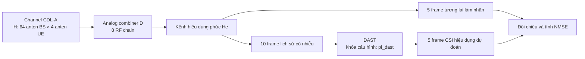
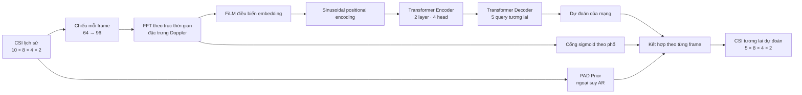
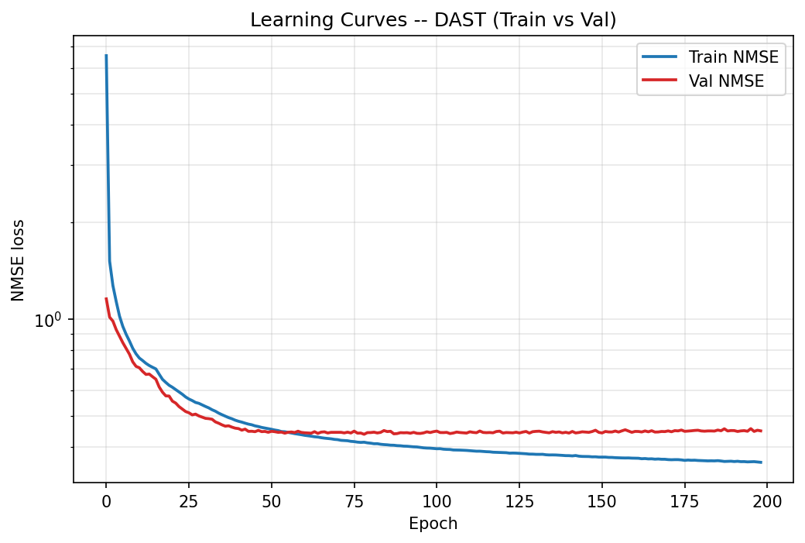
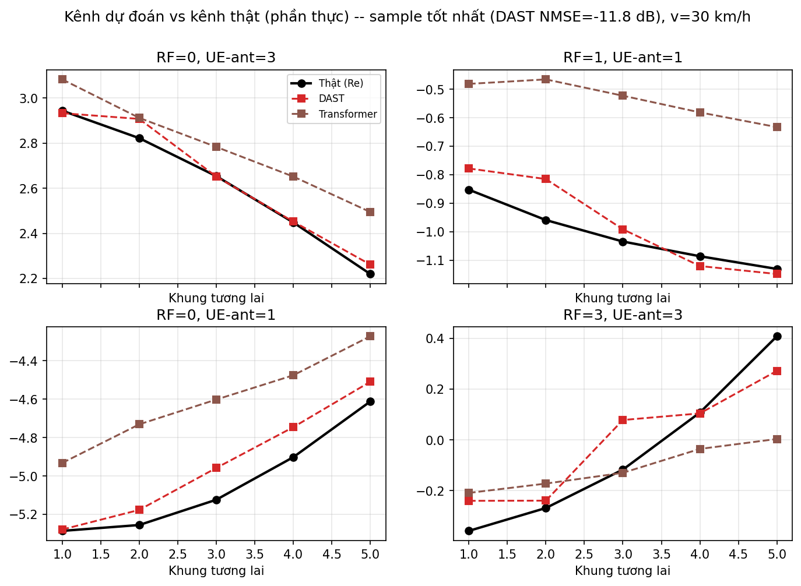

# Dự đoán kênh Massive MIMO với DAST

**DAST** là viết tắt của *Doppler-Adaptive Sequence Transformer*; `pi_dast` là mã định danh kỹ thuật được giữ trong cấu hình và mã nguồn.

Dự án nghiên cứu dự đoán ngắn hạn **CSI hiệu dụng** trong hệ thống Massive MIMO. Mô hình DAST kết hợp Transformer theo thời gian, đặc trưng Doppler ước lượng từ FFT và một nhánh dự đoán tự hồi quy PAD. Trong source code, `pi_dast` vẫn là khóa cấu hình, registry và tên thư mục checkpoint để tương thích với pipeline hiện có.

> **Thiết lập chính:** 10 frame CSI lịch sử → 5 frame CSI tương lai · 64 anten phát · 8 RF chain · 4 anten thu.

## Tổng quan

CSI thay đổi theo thời gian do chuyển động và đa đường. Dự án xây dựng pipeline mô phỏng kênh, biểu diễn CSI phức dưới dạng I/Q, huấn luyện mô hình dự đoán chuỗi và đánh giá sai số dự đoán trên các kịch bản vận tốc.

Mô hình làm việc với **kênh hiệu dụng sau analog combining**, không dự đoán trực tiếp toàn bộ ma trận kênh 64 × 4. Cấu hình dữ liệu hiện tại dùng kênh tổng hợp Sionna CDL-A.

## Mục tiêu bài toán

Với 10 khung lịch sử của kênh hiệu dụng, dự đoán đồng thời 5 khung kế tiếp. Mỗi hệ số kênh phức được biểu diễn bằng hai giá trị thực: phần thực và phần ảo.

| Thành phần | Kích thước |
|---|---:|
| Đầu vào | `(batch, 10, 8, 4, 2)` |
| Đầu ra | `(batch, 5, 8, 4, 2)` |
| Một khung | 8 chuỗi RF × 4 anten thu × 2 kênh I/Q |

## Kiến trúc hệ thống



## Mô hình DAST và Transformer

DAST dùng Transformer encoder-decoder để học phụ thuộc thời gian trong chuỗi CSI. Với cấu hình hiện tại, mỗi frame được làm phẳng thành 64 giá trị thực và chiếu lên embedding 96 chiều. Mô hình có 2 encoder layer, 2 decoder layer, 4 attention head và feed-forward width 192. Tên `pi_dast` chỉ là định danh kỹ thuật trong cấu hình, registry và checkpoint.



### Transformer encoder-decoder

Encoder dùng self-attention để kết hợp thông tin giữa các frame lịch sử. Decoder nhận 5 query học được, có positional encoding cho các bước dự báo, rồi dùng cross-attention với biểu diễn lịch sử đã mã hóa. Năm frame được dự đoán song song.

### Đặc trưng Doppler từ FFT

Nhánh Doppler áp dụng real FFT lên embedding theo trục thời gian, lấy độ lớn phổ, bỏ thành phần DC và tổng hợp theo chiều embedding. Một MLP chuyển phổ này thành hệ số scale/shift để điều biến embedding bằng FiLM. Phổ cũng được dùng để điều kiện hóa cổng kết hợp PAD. Vận tốc không được đưa trực tiếp vào mạng làm feature đầu vào.

### PAD Prior và cổng kết hợp

PAD là nhánh ngoại suy tự hồi quy theo bình phương tối thiểu có regularization, áp dụng cho từng hệ số kênh. Nhánh này không có tham số học được. Cổng sigmoid sinh trọng số theo từng bước tương lai để trộn dự đoán PAD với đầu ra mạng:

```text
Dự đoán = g × PAD + (1 − g) × đầu ra Transformer
```

Cấu hình DAST hiện bật Doppler encoder, PAD prior và cổng học được; nhánh CNN không gian tắt. Chi tiết triển khai nằm trong `src/models/pi_dast.py` và `src/models/pad_torch.py`.

## Quy trình xử lý dữ liệu

1. Sionna tạo chuỗi kênh CDL-A theo cấu hình mô phỏng.
2. Áp dụng analog combiner để tạo kênh hiệu dụng `He = D·H`.
3. Thêm nhiễu AWGN vào phần lịch sử; lưu phần tương lai sạch làm nhãn.
4. Lưu hệ số phức thành hai kênh thực/ảo trong các file mẫu `.npz`.
5. Fit một hệ số chuẩn hóa trên tập train và dùng cùng hệ số đó cho các split.
6. Huấn luyện DAST dự đoán 5 frame tương lai từ 10 frame đầu vào.

### Giới hạn nhân quả của protocol sinh dữ liệu

Trong generator Sionna, cả hai phép tính sau đều dùng toàn bộ chuỗi gồm 10 khung lịch sử và 5 khung tương lai:

- Combiner analog `D` được chọn từ kênh trung bình theo thời gian trên toàn chuỗi.
- Công suất kênh hiệu dụng `He` trên toàn chuỗi được dùng để xác định độ lệch chuẩn AWGN cộng vào phần lịch sử.

Do đó, dù đầu vào trực tiếp của DAST chỉ gồm các khung lịch sử, cách tạo biểu diễn và nhiễu của đầu vào có phụ thuộc vào các khung tương lai. Kết quả hiện tại phản ánh protocol mô phỏng này, chưa phải đánh giá dự đoán online nhân quả với combiner và mức nhiễu chỉ dựa trên thông tin sẵn có tại thời điểm dự đoán. Các phép tính tương ứng nằm trong `scripts/01b_generate_sionna.py`.

## Bộ dữ liệu và cấu hình thực nghiệm

Dataset là dữ liệu mô phỏng, được tạo bằng Sionna CDL-A; repository không mô tả bộ đo kênh vô tuyến ngoài thực địa.

| Split | Số mẫu cấu hình | Kịch bản |
|---|---:|---|
| Train | 8.000 | Vận tốc 10–120 km/h, delay spread 25–250 ns, SNR 5–25 dB |
| Validation | 1.000 | Lấy mẫu trong cùng các khoảng cấu hình train |
| Test | 500 mỗi mức | 30, 50, 70, 90, 120 km/h; delay spread 50 ns; SNR 20 dB |

Các thông số hệ thống gồm tần số mang 30 GHz và khoảng cách frame 0,125 ms. Recipe `exp1` cấu hình tối đa 300 epoch, batch size 64, AdamW với learning rate `1e-3`, weight decay `1e-4`, warmup MSE 10 epoch rồi chuyển sang NMSE; checkpoint được chọn theo NMSE validation. Đây là cấu hình khai báo trong repository, không đồng nghĩa mọi lần chạy đều đi đủ 300 epoch.

## Kết quả thực nghiệm

### Đường cong huấn luyện



*Hình lấy từ artifact `results/figures/learning_curves_pi_dast.png`, tương ứng một run DAST đã lưu trong dự án. Tên file giữ khóa kỹ thuật `pi_dast`.*

### Ví dụ dự đoán và kênh tham chiếu



*Hình lấy từ `results/figures/pred_vs_true_v30.png`. Mẫu được chọn là mẫu có NMSE thấp nhất của DAST trong kịch bản 30 km/h; đây không phải mẫu ngẫu nhiên hay kết quả trung bình của tập test.*

### NMSE theo vận tốc

Bảng dưới đây được chép từ `results/tables/multiseed_table.md`. Training loss và metric evaluation cùng đo sai số bình phương chuẩn hóa, nhưng mẫu số và cách tổng hợp khác nhau:

- **NMSE loss khi huấn luyện:** với từng mẫu `b` và khung tương lai `q`, tổng bình phương sai số trên các thành phần kênh được chia cho tổng bình phương giá trị thật cộng epsilon. Mã loss dùng `epsilon = 1e-8`, rồi lấy trung bình qua batch và các khung tương lai.

$$
\mathrm{NMSE}^{train}_{b,q}=\frac{\sum_d(\hat{y}_{b,q,d}-y_{b,q,d})^2}{\sum_d y_{b,q,d}^2+\epsilon},\qquad \epsilon=10^{-8}
$$

- **NMSE khi đánh giá:** mẫu số của từng mẫu/khung được chặn dưới bằng `1e-12` (`clamp(min=1e-12)`), không cộng epsilon như training loss. Evaluator lấy trung bình NMSE tuyến tính qua mẫu cho từng khung, sau đó trung bình qua các khung tương lai và mới đổi sang dB bằng `10 × log10(NMSE)`.

$$
\mathrm{NMSE}^{eval}_{b,q}=\frac{\sum_d(\hat{y}_{b,q,d}-y_{b,q,d})^2}{\max(\sum_d y_{b,q,d}^2,10^{-12})}
$$

Bảng báo cáo trung bình ± độ lệch chuẩn của NMSE dB qua ba seed (42, 123, 2024). Giá trị thấp hơn biểu thị sai số chuẩn hóa nhỏ hơn.
| Mô hình | 30 km/h | 50 km/h | 90 km/h | 120 km/h |
|---|---:|---:|---:|---:|
| DAST hybrid | −7,17 ± 0,07 | −5,39 ± 0,07 | −3,37 ± 0,03 | −2,12 ± 0,02 |
| DAST bỏ cổng | −6,61 ± 0,06 | −5,14 ± 0,03 | −3,35 ± 0,03 | −2,24 ± 0,03 |
| DAST bỏ PAD | −5,62 ± 0,03 | −4,13 ± 0,05 | −2,47 ± 0,02 | −1,40 ± 0,02 |
| DAST bỏ Doppler encoder | −5,50 ± 0,03 | −4,10 ± 0,03 | −2,43 ± 0,01 | −1,43 ± 0,04 |
| Transformer | −5,47 ± 0,07 | −4,09 ± 0,04 | −2,41 ± 0,04 | −1,38 ± 0,06 |

Các giá trị trên là kết quả đã lưu trong repository, không phải kết quả được chạy lại khi biên soạn README. Bảng multi-seed hiện có không liệt kê mức 70 km/h.

## Cài đặt môi trường

Tạo môi trường ảo và cài các dependency runtime tối thiểu:

```bash
python -m venv .venv
```

Kích hoạt môi trường:

```powershell
# Windows PowerShell
.venv\Scripts\Activate.ps1
```

```bash
# macOS / Linux
source .venv/bin/activate
```

Cài đặt dependency:

```bash
python -m pip install -r requirements-minimal.txt
```

Để sinh dữ liệu mới, cài thêm dependency Sionna theo `requirements-sionna.txt` trong môi trường tương thích. Các thành phần giao diện và báo cáo mở rộng được liệt kê trong `requirements-optional.txt`.

Các file requirements hiện liệt kê dependency trực tiếp nhưng chưa khóa phiên bản; repository cũng chưa khai báo phiên bản Python hay bộ phiên bản PyTorch/CUDA/Sionna đã xác nhận. Vì vậy lệnh cài đặt giúp dựng môi trường ban đầu nhưng chưa bảo đảm tái lập chính xác giữa các máy. Chỉ nên tạo lock file sau khi chọn và xác nhận một môi trường mục tiêu; PyTorch cần được chọn theo nền tảng CPU/CUDA, còn Sionna cần được kiểm tra tương thích với bộ đó.

## Hướng dẫn chạy

### Sinh dữ liệu Sionna

```bash
python scripts/01b_generate_sionna.py --config configs/data/sionna_cdl.yaml
```

### Huấn luyện DAST

Lệnh dưới đây sử dụng dữ liệu đã sinh trong `data_sionna/`:

```bash
python scripts/02_train.py --model pi_dast --train_config exp1 --model_config configs/model/pi_dast.yaml --data_dir data_sionna --seed 42 --exp_name pi_dast_exp1_seed42
```

### Tái tạo bảng nhiều seed

Cần có thống kê chuẩn hóa, các tập kiểm thử và `checkpoint_best.pt` của năm mô hình/biến thể trong `scripts/aggregate_multiseed.py`, với đủ ba seed 42, 123 và 2024. Script kiểm tra tất cả checkpoint trước khi tổng hợp. Nếu thiếu checkpoint, script dừng và liệt kê các mục còn thiếu. Khi đã có đủ dữ liệu, lệnh dưới đây tính lại và ghi đè `results/tables/multiseed_table.md`:

```bash
python scripts/aggregate_multiseed.py
```
### Đánh giá checkpoint

Cần có dữ liệu test, thống kê chuẩn hóa và checkpoint tương ứng. Lệnh evaluator ghi lại bảng và biểu đồ trong `results/`; các file trùng tên có thể bị ghi đè. Lệnh dưới đây bỏ qua các sweep, BER, complexity và ablation nhưng vẫn chạy đánh giá scenario, sum-rate, CDF và tạo một số biểu đồ/kết quả. Chỉ chạy khi chấp nhận cập nhật các artifact tương ứng:

```bash
python evaluate.py --data_dir data_sionna --exp_suffix exp1_seed42 --skip_sweeps --skip_ber --skip_complexity --skip_ablation
```

## Cấu trúc thư mục

```text
.
├── app.py                    # Giao diện Gradio
├── evaluate.py               # Đánh giá, biểu đồ và bảng kết quả
├── configs/
│   ├── data/                 # Cấu hình sinh dữ liệu
│   ├── model/                # DAST và các mô hình đối chứng
│   └── train/                # Cấu hình huấn luyện
├── scripts/                  # Sinh dữ liệu, huấn luyện, tổng hợp kết quả
├── src/
│   ├── data/                 # Dataset, sinh kênh, chuẩn hóa
│   ├── models/               # DAST, PAD/Kalman và baseline
│   ├── losses/               # Hàm mất mát
│   ├── training/             # Trainer, optimizer, scheduler
│   └── evaluation/           # Metric và quy trình đánh giá
├── results/
│   ├── figures/              # Biểu đồ đã lưu
│   └── tables/               # Bảng và kết quả tổng hợp
└── tests/                    # Kiểm tra shape và ngân sách tham số
```

## Công nghệ sử dụng

- Python, PyTorch và NumPy
- Sionna cho mô phỏng kênh CDL-A
- Transformer encoder-decoder, FFT và FiLM
- Matplotlib cho biểu đồ kết quả
- Gradio cho giao diện trình diễn

## Giới hạn và hướng phát triển

- Kịch bản hiện tại dùng kênh tổng hợp CDL-A băng hẹp với một subcarrier; kết quả chưa đại diện cho kênh đo thực địa hoặc hệ thống đa subcarrier.
- Khi sinh dữ liệu, combiner analog được chọn từ kênh trung bình trên toàn chuỗi gồm cả các frame tương lai (`scripts/01b_generate_sionna.py`). Vì vậy, kết quả cần được hiểu trong phạm vi protocol mô phỏng này; đánh giá dự đoán online cần protocol chọn combiner chỉ dùng thông tin có sẵn tại thời điểm đó.
- Test cố định SNR và delay spread, đồng thời thay đổi vận tốc; đánh giá trên tổ hợp điều kiện rộng hơn là hướng phát triển tiếp theo.

## Tài liệu tham khảo

1. 3GPP, [TR 38.901 – Mô hình kênh cho tần số từ 0,5 đến 100 GHz](https://portal.3gpp.org/desktopmodules/Specifications/SpecificationDetails.aspx?specificationId=3173).
2. NVIDIA, [Sionna – Channel Models](https://nvlabs.github.io/sionna/phy/api/channel/channel.html) và [CDL API](https://nvlabs.github.io/sionna/v2.2.0/phy/api/channel/wireless/sionna.phy.channel.tr38901.CDL.html).
3. Vaswani và cộng sự, [Attention Is All You Need](https://arxiv.org/abs/1706.03762).
4. PyTorch, tài liệu [TransformerEncoderLayer](https://docs.pytorch.org/docs/stable/generated/torch.nn.TransformerEncoderLayer.html) và [TransformerDecoderLayer](https://docs.pytorch.org/docs/stable/generated/torch.nn.TransformerDecoderLayer.html).
